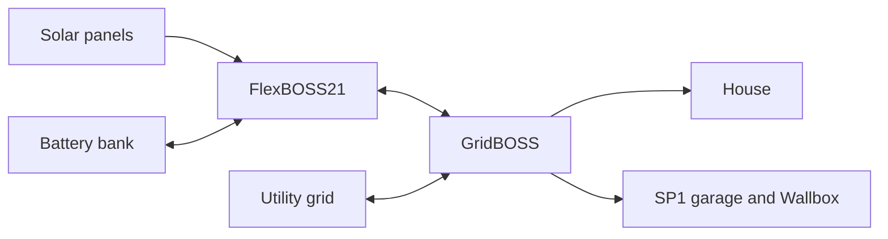

# Home Assistant

Solar and EV charging notes from 2026-11-01. Configuration lives in
[default.nix](default.nix); the running instance is <https://hast.breakds.org>.

## Hardware

- EG4 FlexBOSS21 hybrid inverter, connected to an EG4 GridBOSS gateway.
- GridBOSS supplies the house and SP1, which supplies the garage, including the
  Wallbox Pulsar Plus charger. Total load includes both branches, confirmed by
  Break.
- Two EG4 WallMount All Weather batteries, each 51.2 V, 280 Ah / 14.3 kWh.
  Combined capacity is 560 Ah, about 28.6 kWh nominal. One percentage point of
  charge is about 0.29 kWh; usable energy depends on reserve and losses.
- Vehicle: US-market 2025 Volkswagen ID. Buzz. No vehicle integration is installed.

The FlexBOSS21 connects to GridBOSS through its terminal named GRID. That terminal
carries power in both directions; its power reading is not necessarily utility
import/export. SP1 can be supplied by solar, battery, or grid power.

References: [GridBOSS manual](https://eg4electronics.com/wp-content/uploads/2024/07/EG4-Grid-BOSS-User-Manual.pdf),
[battery specifications](https://eg4electronics.com/categories/batteries/eg4-wallmount-all-weather-battery/).

## Power readings

SolarAssistant at `10.77.1.52` publishes to Home Assistant over MQTT. The device
appears as `Luxpower LXP`, with entities named `eg4_*`.

| Entity | Meaning |
| --- | --- |
| `sensor.eg4_pv_power` | Total solar production, W. |
| `sensor.eg4_load_power` | Combined house and garage demand, including Wallbox, W. |
| `sensor.eg4_battery_state_of_charge` | Combined home-battery charge level, %. |
| `sensor.eg4_battery_power` | Positive when charging, negative when discharging, W. |
| `sensor.eg4_grid_power` | Reported net utility power; positive import, negative export, W. Only the zero-flow case has been checked against actual conditions. |
| `sensor.eg4_grid_power_ld` | Working interpretation: power through the FlexBOSS GRID terminal toward/from GridBOSS. Negative while supplying GridBOSS. Exact register mapping remains unverified. |

In one observed snapshot, solar was 3,522 W, total load 1,106 W, battery charging
2,254 W, grid power 0 W, and Grid power LD -1,106 W. Break confirmed utility input
was zero and whole-house load about 1,100 W. The roughly 160 W balance difference
can include conversion losses and measurement timing.

Do not add Grid power LD to load power: that would count the observed flow twice.
The generic essential/non-essential load labels should not be equated with the
house/SP1 branches. A zero essential-load reading does not mean the house is idle.
No separate SP1 power entity was found in Home Assistant.

See [SolarAssistant's power sign conventions](https://origin.solar-assistant.io/help/integration/rest-api#topic-structure).

## Wallbox

The built-in integration uses myWallbox cloud access through an invited
email/password account with Admin rights in the charger's organization. The owner
uses Apple sign-in. Cloud data normally refreshes every 90 seconds.

| Entity | Purpose |
| --- | --- |
| `sensor.wallbox_pulsar_plus_sn_1347792_status_description` | Charger status. |
| `sensor.wallbox_pulsar_plus_sn_1347792_charging_power` | Charging power, kW; EG4 power sensors use W. |
| `number.wallbox_pulsar_plus_sn_1347792_maximum_charging_current` | Current limit, A. Observed setting: 24 A; exposed range: 6–40 A. Preserve the existing cap until deliberately changed. |
| `switch.wallbox_pulsar_plus_sn_1347792_pause_resume` | On resumes charging; off pauses it. Unavailable in Ready state is expected. |

The UI-managed [Vehicle dashboard](https://hast.breakds.org/dashboard-vehicle/home)
contains Wallbox readings, controls, and 24-hour power history.

Control the charger through Wallbox; switching SP1 would interrupt other garage
loads too. The solar-charging goal does not require vehicle battery telemetry.
The charging algorithm is deferred, and no solar forecast feed or charging
automation is configured in Home Assistant.

See the [Wallbox integration documentation](https://www.home-assistant.io/integrations/wallbox/).

## Checks before automation

- Compare HA grid power with GridBOSS monitoring during nonzero utility import or
  export to confirm meter coverage and direction.
- Compare battery charge level with the battery/EG4 display and confirm the power
  sign during both charging and discharging.
- With the car below its charge target and schedules allowing charging, test
  6 A then 12 A through HA; expect roughly 1.5 kW then 3 kW. Observe total load,
  grid power, and battery power at the same time.
- Test pause, then resume after several minutes without unplugging. Allow about
  two minutes for cloud feedback. Also test resume after a longer idle period.
- Check charger status after unplug/replug and when the car reaches its charge
  target. Read access is confirmed; actual charging commands remain untested.
